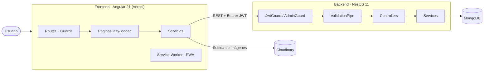
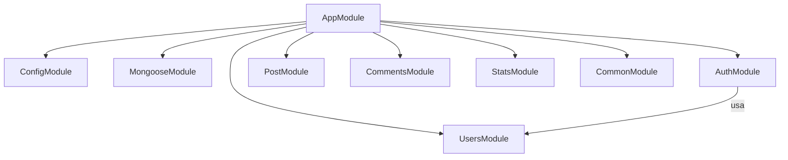
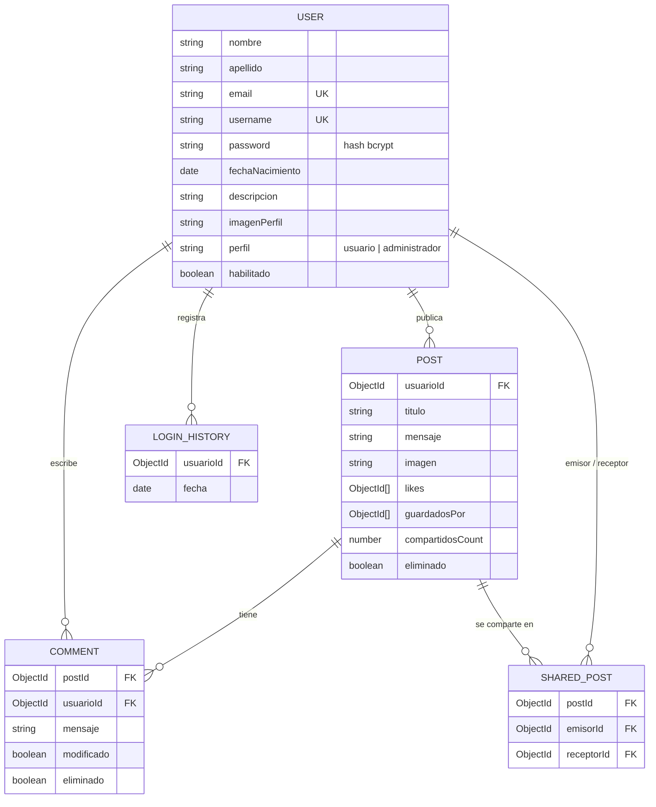
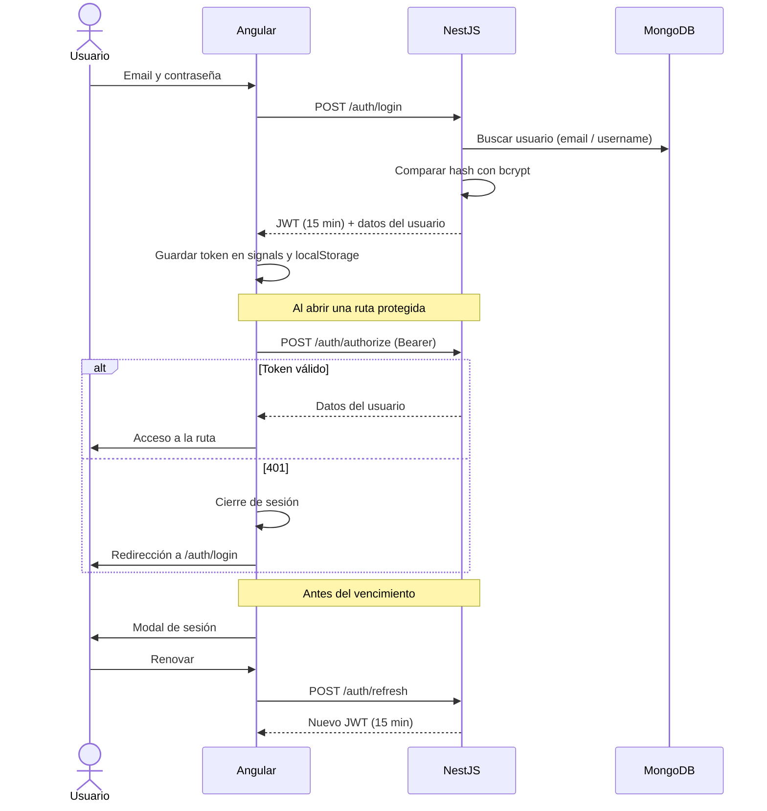
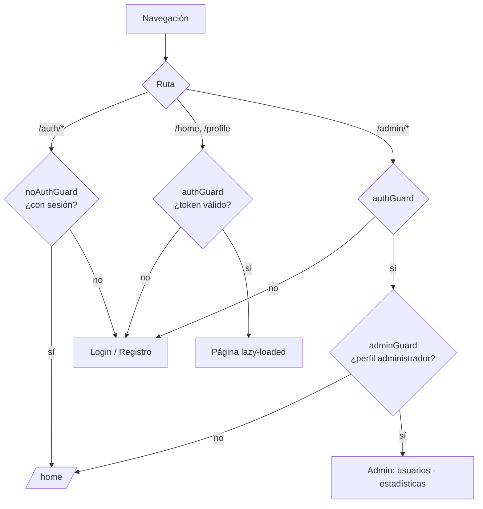

<div align="center">

# Red Social

**Plataforma full-stack de red social con feed, comentarios, panel de administración y estadísticas.**


</div>

---

## Tabla de contenidos

- [Descripción](#descripción)
- [Funcionalidades](#funcionalidades)
- [Stack tecnológico](#stack-tecnológico)
- [Arquitectura](#arquitectura)
- [Primeros pasos](#primeros-pasos)
- [Variables de entorno](#variables-de-entorno)
- [Docker](#docker)
- [API REST](#api-rest)
- [Scripts disponibles](#scripts-disponibles)
- [Testing](#testing)
- [Despliegue](#despliegue)
- [Autor](#autor)

## Descripción

**Red Social** es una aplicación web full-stack desarrollada como Trabajo Práctico Integrador de *Programación IV* (2026 C1). Permite a los usuarios registrarse, publicar contenido, interactuar mediante *likes* y comentarios, y ofrece a los administradores herramientas de gestión de usuarios y un dashboard de estadísticas.

El proyecto está compuesto por dos aplicaciones independientes:

| Componente | Ruta | Descripción |
|---|---|---|
| **Backend** | [`red-social-backend/`](red-social-backend) | API REST con NestJS y MongoDB |
| **Frontend** | [`red-social-frontend/`](red-social-frontend) | SPA con Angular, Tailwind CSS y soporte PWA |

## Funcionalidades

### Autenticación y sesión
- Registro con contraseña encriptada (bcrypt) e imagen de perfil (Cloudinary).
- Login con JWT de 15 minutos de duración.
- Validación de token en una pantalla de carga con redirección automática.
- Modal de sesión que avisa antes del vencimiento y permite renovar el token (`/auth/refresh`).
- Cierre de sesión automático ante respuestas `401`.

### Publicaciones
- Feed ordenable por fecha o cantidad de *likes*, con paginación (`offset` / `limit`).
- Alta y baja lógica de publicaciones; solo el autor o un administrador puede eliminar.
- *Like* / *unlike* (un único *like* por usuario).
- Filtro por usuario y perfil con las últimas publicaciones.

### Comentarios
- Listado paginado con los más recientes primero.
- Edición de comentarios propios, con indicador de "editado".
- Página de detalle de publicación con carga incremental de comentarios.

### Administración (rol `administrador`)
- Gestión de usuarios: listar, crear (usuario o administrador), deshabilitar y rehabilitar.
- Dashboard de estadísticas con gráficos (Chart.js) filtrables por rango de fechas:
  - Publicaciones por usuario.
  - Comentarios en un lapso de tiempo.
  - Comentarios por publicación.

### Experiencia de usuario
- Progressive Web App (service worker).
- 3 *pipes* propios (`format-date`, `relative-date`, `truncate`).
- 3 directivas propias (`auto-focus`, `click-outside`, `debounce-click`).

## Stack tecnológico

**Backend**
- [NestJS 11](https://nestjs.com/) · TypeScript
- MongoDB con [Mongoose](https://mongoosejs.com/)
- Passport + JWT (`@nestjs/jwt`, `passport-jwt`)
- `bcrypt`, `class-validator`, `class-transformer`
- Jest + Supertest

**Frontend**
- [Angular 21](https://angular.dev/) (signals, componentes *standalone*, rutas *lazy-loaded*)
- [Tailwind CSS 4](https://tailwindcss.com/)
- [Chart.js](https://www.chartjs.org/)
- Angular Service Worker (PWA)
- Vitest

**Herramientas:** pnpm · ESLint · Prettier · Docker · Vercel

## Arquitectura

```
Red-social/
├── red-social-backend/          # API NestJS
│   └── src/
│       ├── auth/                # Registro, login, JWT, refresh, authorize
│       ├── users/               # CRUD de usuarios (rol administrador)
│       ├── post/                # Publicaciones, likes, baja lógica
│       ├── comments/            # Comentarios
│       ├── stats/               # Estadísticas para el dashboard
│       └── common/              # Errores e interfaces compartidas
├── red-social-frontend/         # SPA Angular
│   └── src/app/
│       ├── core/                # Servicios, guards, interceptors, layouts, modelos
│       ├── features/            # home, auth, profile, admin, loading (lazy)
│       └── shared/              # Componentes, pipes y directivas reutilizables
├── docker-compose.yml
└── README.md
```

### Decisiones de arquitectura

#### Backend (NestJS)

| Decisión | Implementación | Motivo |
|---|---|---|
| **Arquitectura modular** | Un módulo por dominio (`auth`, `users`, `post`, `comments`, `stats`, `common`) con su controller, service, DTOs y schemas | Bajo acoplamiento y responsabilidades claras |
| **Autenticación stateless** | JWT (`sub`, `email`, `username`, `perfil`) validado por una estrategia Passport y `JwtGuard` | Escala sin sesiones en servidor |
| **Autorización por rol** | `AdminGuard` en las rutas de `users` y `stats` | Separa permisos de administrador y usuario |
| **Pipes de validación** | `ValidationPipe` global con `whitelist`, `forbidNonWhitelisted` y `transform`, sobre DTOs con `class-validator` | Rechaza campos desconocidos y tipa la entrada antes de llegar al servicio |
| **Baja lógica** | Flag `eliminado: true` en lugar de borrar documentos | Conserva el histórico y las estadísticas |
| **Errores de dominio** | Clases de error base en `common/errors` (p. ej. `UnauthorizedError`) | Manejo de errores consistente entre módulos |
| **Contraseñas** | Hash con `bcrypt` | Nunca se guardan en texto plano |

Ciclo de una petición: `Request → Guards (JWT / rol) → Pipes (validación de DTO) → Controller → Service → Mongoose → MongoDB`.

#### Frontend (Angular)

| Decisión | Implementación | Motivo |
|---|---|---|
| **Lazy loading** | `loadComponent` en cada página y `loadChildren` para los módulos de `auth` y `admin`; las pantallas de usuarios y estadísticas se cargan a demanda dentro de admin | Menor *bundle* inicial y carga más rápida |
| **Componentes *standalone*** | Sin `NgModule`; configuración central en `app.config.ts` | Modelo actual de Angular, menos *boilerplate* |
| **Guards de ruta** | `authGuard` (valida el token localmente y contra `/auth/authorize`), `adminGuard` y `noAuthGuard` | Protege las rutas según sesión y rol |
| **Layouts anidados** | `MainLayout` envuelve las rutas y `AdminLayout` el panel de administración | Reutiliza la estructura común de pantalla |
| **Estado con *signals*** | `NestAuthService` expone token, usuario e `isAuthenticated` (*computed*) y persiste en `localStorage` | Estado reactivo simple, sin librerías externas |
| **Capa de servicios** | Servicios por dominio (`auth`, `posts`, `comments`, `admin`, `cloudinary`) que centralizan el acceso a la API | Los componentes no conocen detalles HTTP |
| **Manejo de 401** | `authenticatedFetch` agrega el Bearer token y cierra sesión automáticamente ante un `401`; existe además un `AuthInterceptor` para `HttpClient` | Sesión coherente ante tokens vencidos |
| **Pipes propias** | `format-date`, `relative-date`, `truncate` | Lógica de presentación reutilizable y fuera de las plantillas |
| **Directivas propias** | `auto-focus`, `click-outside`, `debounce-click` | Comportamiento de DOM reutilizable |
| **PWA** | Service worker (`ngsw-config.json`), activo solo en producción y registrado cuando la app está estable | Instalable y con recursos en caché |
| **Entornos separados** | `environment.development.ts` y `environment.ts` | URL de API distinta según el entorno |

#### Calidad y operación

- **Contenedores:** `docker-compose.yml` con límites de memoria/CPU, *healthcheck* del backend y dependencia de arranque del frontend.
- **Calidad de código:** ESLint y Prettier en el backend, tests con Jest (backend) y Vitest (frontend).
- **Despliegue:** frontend en Vercel con *rewrite* a `index.html` para la SPA.
- **Gestor de paquetes:** pnpm en ambos proyectos.

> **Nota:** el proyecto aún no tiene *pipeline* de CI/CD (por ejemplo, GitHub Actions). Es una mejora pendiente: ejecutar lint, tests y build en cada *push*.

### Diagramas

> Los diagramas están en [Mermaid](https://mermaid.js.org/) y se renderizan automáticamente en GitHub.

#### Vista general del sistema



#### Módulos del backend



#### Modelo de datos



#### Flujo de autenticación



#### Protección de rutas en el frontend



## Primeros pasos

### Requisitos previos

- [Node.js](https://nodejs.org/) 22+
- [pnpm](https://pnpm.io/) (`corepack enable`)
- Una instancia de MongoDB (local o [MongoDB Atlas](https://www.mongodb.com/atlas))
- Cuenta de [Cloudinary](https://cloudinary.com/) para las imágenes de perfil

### Instalación

```bash
git clone <url-del-repositorio>
cd Red-social
```

**Backend**

```bash
cd red-social-backend
pnpm install
# Crear el archivo .env (ver "Variables de entorno")
pnpm run start:dev        # http://localhost:3000
```

**Frontend**

```bash
cd red-social-frontend
pnpm install
pnpm run start            # http://localhost:4200
```

## Variables de entorno

**Backend** — `red-social-backend/.env`

| Variable | Descripción | Ejemplo |
|---|---|---|
| `PORT` | Puerto de la API | `3000` |
| `DATABASE_URL` | Cadena de conexión a MongoDB | `mongodb+srv://...` |
| `JWT_SECRET` | Secreto para firmar los tokens | `un-secreto-largo-y-aleatorio` |
| `JWT_EXPIRES` | Duración del token | `15m` |

**Frontend** — `red-social-frontend/src/environments/`

| Archivo | Uso | `apiUrl` |
|---|---|---|
| `environment.development.ts` | Desarrollo | `http://localhost:3000/` |
| `environment.ts` | Producción | URL del backend desplegado |

> No subas archivos `.env` ni secretos al repositorio.

## Docker

El archivo [`docker-compose.yml`](docker-compose.yml) levanta backend y frontend con límites de recursos y *healthcheck*:

```bash
docker compose up --build
```

| Servicio | Puerto |
|---|---|
| Backend | `3000` |
| Frontend | `4200` |

El frontend espera a que el backend esté saludable antes de iniciar. Las variables se toman del `.env` de la raíz.

## API REST

Todas las rutas, salvo registro y login, requieren el encabezado `Authorization: Bearer <token>`.

### Auth — `/auth`

| Método | Ruta | Descripción |
|---|---|---|
| `POST` | `/auth/register` | Registrar un usuario |
| `POST` | `/auth/login` | Iniciar sesión |
| `POST` | `/auth/authorize` | Validar token y obtener datos del usuario |
| `POST` | `/auth/refresh` | Emitir un nuevo token |
| `GET` | `/auth/profile` | Perfil del usuario autenticado |
| `GET` | `/auth/navbar` | Datos para la barra de navegación |

### Publicaciones — `/posts`

| Método | Ruta | Descripción |
|---|---|---|
| `POST` | `/posts` | Crear publicación |
| `GET` | `/posts` | Listar (query: orden, usuario, `offset`, `limit`) |
| `GET` | `/posts/:id` | Obtener una publicación |
| `DELETE` | `/posts/:id` | Baja lógica (autor o administrador) |
| `POST` | `/posts/:id/like` | Dar *like* |
| `DELETE` | `/posts/:id/like` | Quitar *like* |

### Comentarios — `/comments`

| Método | Ruta | Descripción |
|---|---|---|
| `GET` | `/comments` | Listar comentarios paginados |
| `POST` | `/comments` | Crear comentario |
| `PATCH` | `/comments/:id` | Editar comentario propio |
| `DELETE` | `/comments/:id` | Eliminar comentario |

### Usuarios — `/users` *(administrador)*

| Método | Ruta | Descripción |
|---|---|---|
| `GET` | `/users` | Listar usuarios |
| `POST` | `/users` | Crear usuario o administrador |
| `DELETE` | `/users/:id` | Deshabilitar usuario |
| `POST` | `/users/:id/enable` | Rehabilitar usuario |

### Estadísticas — `/stats` *(administrador)*

| Método | Ruta | Descripción |
|---|---|---|
| `GET` | `/stats/posts-by-user` | Publicaciones por usuario |
| `GET` | `/stats/comments-over-time` | Comentarios en un lapso de tiempo |
| `GET` | `/stats/comments-by-post` | Comentarios por publicación |

## Scripts disponibles

**Backend** (`red-social-backend/`)

| Comando | Descripción |
|---|---|
| `pnpm run start:dev` | Servidor de desarrollo con *watch* |
| `pnpm run build` | Compila el proyecto |
| `pnpm run start:prod` | Ejecuta la build compilada |
| `pnpm run lint` | ESLint con autofix |
| `pnpm run format` | Prettier |

**Frontend** (`red-social-frontend/`)

| Comando | Descripción |
|---|---|
| `pnpm run start` | Servidor de desarrollo |
| `pnpm run build` | Build de producción |
| `pnpm run watch` | Build en modo *watch* |

## Testing

```bash
# Backend
cd red-social-backend
pnpm run test          # unitarios (Jest)
pnpm run test:e2e      # end-to-end
pnpm run test:cov      # cobertura

# Frontend
cd red-social-frontend
pnpm run test          # Vitest
```

## Despliegue

- **Frontend:** desplegado en [Vercel](https://vercel.com/). [`vercel.json`](red-social-frontend/vercel.json) redirige todas las rutas a `index.html` para soportar el enrutamiento de la SPA.
- **Backend:** API NestJS conectada a MongoDB Atlas, configurada mediante variables de entorno.

## Autor

**Juan Manuel** — [@Juanma7882](https://github.com/Juanma7882)

Proyecto académico — Programación IV, 2026.
